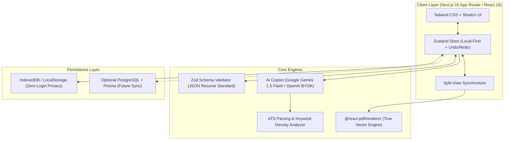
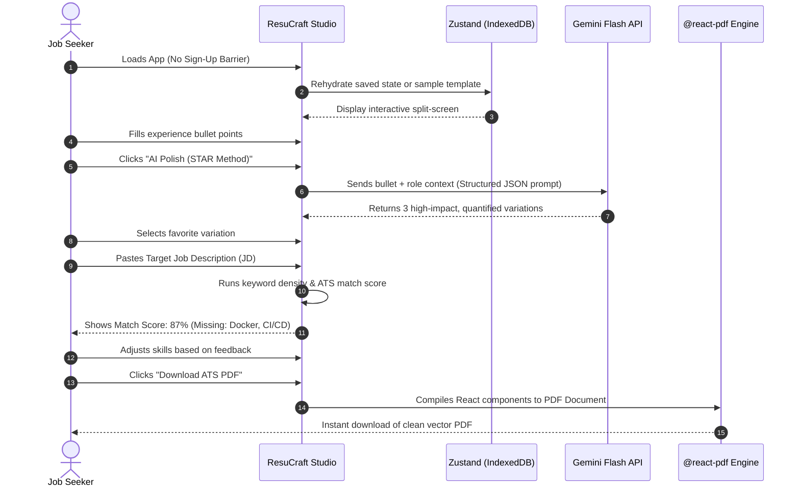

# ResuCraft AI — Product Requirements Document (PRD) & Strategy

---

## 1. Executive Market Analysis & Problem Statement

### 1.1 The Industry Problem in 2026
The global online resume builder market exceeds $1.8B, yet job seekers face severe friction:

1. **The "Predatory Paywall Trap":** Legacy builders (Zety, Resume.io, Novoresume) employ deceptive onboarding: users spend 45 minutes meticulously crafting a resume only to be hit with a mandatory $19–$29/month auto-recurring subscription at the final "Download PDF" step.
2. **The "ATS Black Hole":** Over 75% of resumes submitted to mid-to-large companies are filtered by Applicant Tracking Systems (Workday, Greenhouse, Lever, Taleo) before a human recruiter ever sees them. Most visually appealing templates use floating text boxes, multi-column CSS tables, and icons that corrupt ATS text parsers into unreadable gibberish.
3. **Generic & Hallucinatory AI:** First-generation AI resume builders generate repetitive, buzzword-laden paragraphs (*"proven team player with synergistic abilities"*) that recruiters instantly recognize and discard. They lack contextual alignment with actual Job Descriptions (JDs).
4. **Data Privacy Concerns:** Users are increasingly unwilling to store their complete career histories, phone numbers, and addresses on opaque, ad-supported SaaS servers that scrape resume data for model training.

### 1.2 The Competitive Landscape

| Platform | Strengths | Critical Weaknesses | Our Strategic Opportunity |
| :--- | :--- | :--- | :--- |
| **Reactive Resume** | Open-source, clean UI, multi-language | Complex self-hosting setup, lacks integrated JD matching | Provide out-of-the-box hosted speed + real-time ATS matcher |
| **Teal / Jobscan** | Great keyword matching and tracker | Expensive ($29–$49/mo), clunky editor | Clean, developer-grade speed + BYOK AI integration |
| **FlowCV** | Beautiful visual design | High paywalls for multiple versions, limited AI | Zero-paywall core, modular templates, export as JSON/PDF |
| **OpenResume** | Local-first, fast ATS scanner | Limited customization, bare-bones templates | Full interactive editor + intelligent bullet enhancer |

### 1.3 The Core Solution: Dual-Output Career Engine
Our product bridges the gap between **ATS Compliance (Machine-Readable)** and **Modern Portfolio Polish (Human-Delight)**:
* **Output A (For Machines):** Single-column or clean-grid, vector-rendered, text-selectable PDF certified to score 95%+ on Workday and Greenhouse parsers.
* **Output B (For Humans):** An interactive, responsive web version with dark mode, live GitHub project feeds, and verified credential links.

---

## 2. Product Branding & Identity

* **Selected Working Brand:** **ResuCraft AI**  
* **Tagline:** *The Open, ATS-Proof AI Resume Engine.*  
* **Alternatives Considered:** AlignCV, CurriculumOS, VektorCV.

---

## 3. Product Requirements Document (PRD)

### 3.1 Product Vision & Goals
* **Target Audience:** Software Engineers, Tech Professionals, Product Managers, and ambitious career switchers.
* **Core North Star:** Allow any candidate to build, tailor against a specific job description, and export a verified 95%+ ATS-compatible PDF in under 5 minutes without ever seeing a paywall.
* **Engineering Objective:** Showcase senior-level software craftsmanship (React 19 / Next.js 15, TypeScript strict mode, Zod validation, modular architecture, and deterministic PDF rendering).

---

### 3.2 System Architecture & Tech Stack

#### Tech Stack Specification

| Component | Technology | Rationale |
| :--- | :--- | :--- |
| **Framework** | Next.js 15 (App Router, Server Actions) | Production standard, instant SSR/SSG, fast API routing |
| **Language** | TypeScript (Strict Mode) | Type safety across resume schemas and AI JSON outputs |
| **Styling** | Tailwind CSS v4 + Shadcn UI | Accessible, headless, zero-bloat modern interface |
| **State Management** | Zustand (with Temporal middleware) | Lightweight, persistent state with built-in undo/redo |
| **Data Standard** | JSON Resume (`jsonresume.org`) | Standardized open format; seamless import/export |
| **PDF Generation** | `@react-pdf/renderer` | Client-side, pure vector PDF generation (no blur, 100% selectable text) |
| **AI LLM API** | Google Gemini 1.5 Flash / OpenAI (BYOK) | Low latency, high reasoning quality, structured JSON outputs |
| **Schema Validation** | Zod v3 | Runtime validation for form inputs and AI responses |

---

### 3.3 Feature Matrix (MVP vs Future Roadmap)

| Feature | Description | MVP (Phase 1) | Phase 2 | Phase 3 |
| :--- | :--- | :---: | :---: | :---: |
| **Split-Pane Editor** | Form on left, real-time reactive preview on right | ✅ | ✅ | ✅ |
| **ATS-Engineered Templates** | Minimalist Single-Column & Modern Double-Header | ✅ | ✅ | ✅ |
| **JSON Resume Import/Export**| Full import/export of standardized JSON | ✅ | ✅ | ✅ |
| **Vector PDF Export** | Client-side 1-click vector PDF generation | ✅ | ✅ | ✅ |
| **AI Bullet Polish (BYOK)** | Enhances weak bullets into STAR method (Action + Metric) | ✅ | ✅ | ✅ |
| **Job Description Matcher** | Compares resume text with JD, flags missing keywords | ✅ | ✅ | ✅ |
| **Local-First Privacy** | Auto-saves to browser storage without mandatory sign-up | ✅ | ✅ | ✅ |
| **Cover Letter Generator** | Generates matching 1-page cover letter from resume + JD | ❌ | ✅ | ✅ |
| **Application Kanban Board**| Tracks job applications, interviews, and statuses | ❌ | ✅ | ✅ |
| **Hosted Web Resume URL** | Generates sharable public link (`resucraft.app/v/vikash`) | ❌ | ❌ | ✅ |

---

## 4. End-to-End User Flow

---

## 5. Professional Engineering Standards

* **Conventional Commits:** Strict semantic commits (`feat(editor): ...`, `fix(pdf): ...`, `refactor(store): ...`).
* **Modular Clean Code:** Separation of UI components, business logic, schemas, and AI prompts.
* **Type Safety:** 100% TypeScript strict coverage with runtime Zod guards.
* **Testing & CI:** Automated GitHub Actions pipeline for linting, typechecks, and unit tests.
