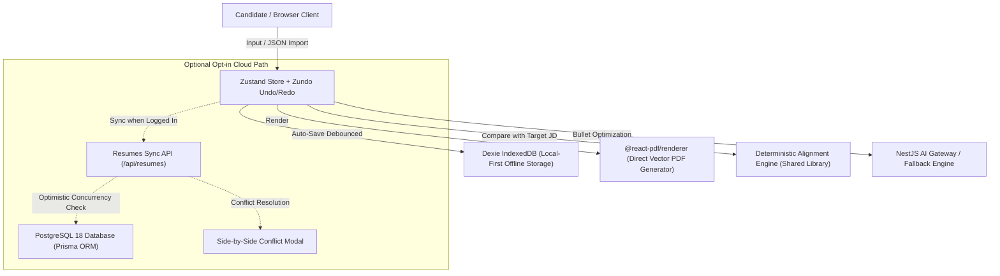

# ResuCraft AI — System Architecture & Engineering Specification

## 1. Executive Summary

ResuCraft AI is an enterprise-grade, privacy-first, ATS-conscious AI Resume Builder and Job Description Alignment platform. The system is engineered around a **Local-First & Non-Blocking Anonymous Guarantee**: users can draft, tailor, optimize, and export resumes 100% offline in their browser without mandatory accounts, paywalls, or third-party data tracking.

---

## 2. Monorepo Architecture

The repository is organized as a clean npm workspaces monorepo:

```text
interactive-resume-template/
├── apps/
│   ├── web/                     # Next.js 15 (App Router, React 19, Tailwind v4)
│   │   ├── src/app/             # Pages: / (Marketing Launch) & /editor (Studio)
│   │   ├── src/components/      # UI, Section Form Editors, Templates, Modals
│   │   ├── src/lib/             # Dexie DB, Better Auth Client, PDF Vector Engine
│   │   ├── src/store/           # Zustand state with Zundo temporal history
│   │   └── e2e/                 # Playwright end-to-end user journey tests
│   │
│   └── api/                     # NestJS 11 (Express, Prisma ORM, Helmet)
│       ├── prisma/              # schema.prisma (Users, Sessions, Resumes)
│       ├── src/health/          # Liveness & database telemetry endpoint
│       ├── src/auth/            # Better Auth controller & session guard
│       ├── src/ai/              # AI Gateway (Gemini Flash + offline fallback)
│       └── src/resumes/         # Cloud sync & optimistic conflict resolution
│
├── packages/
│   └── shared/                  # Zero-dependency TypeScript library
│       ├── src/schemas/         # Zod schemas (ResumeData, AI, Sync, Alignment)
│       ├── src/alignment/       # Deterministic offline JD parser & matcher
│       └── src/types/           # Shared API request/response contracts
│
├── docs/                        # Comprehensive architectural & operational docs
├── package.json                 # Monorepo root scripts (build, test, prisma)
└── README.md                    # Primary repository overview
```

---

## 3. Data Flow Architecture



---

## 4. Architectural Pillars & Design Decisions

### A. Local-First Anonymous Guarantee
- **No Mandatory Registration:** Users can use all core product capabilities (editor, ATS single-column template, PDF export, deterministic JD analysis, AI bullet assistance) anonymously.
- **Dexie IndexedDB:** Provides robust browser persistence across reloads.
- **Data Exportability:** Direct export and import using the official JSON Resume specification.

### B. Deterministic ATS Alignment Engine
- **Zero AI Dependency:** Operates 100% offline via `packages/shared`.
- **Explainable Scoring:** Distinguishes between **Required Qualifications** (70% weight) and **Preferred Qualifications** (30% weight).
- **Technical Aliases:** Maps synonyms (e.g. `React.js` ➔ `React`, `TS` ➔ `TypeScript`, `Postgres` ➔ `PostgreSQL`) without inflating false matches.

### C. Anti-Hallucination AI Assistant
- **Schema Validation:** Uses Vercel AI SDK with Google Gemini provider abstraction (`gemini-1.5-flash` / `gemini-2.0-flash`), validated with Zod.
- **Factual Integrity Guardrails:** The model is strictly instructed never to fabricate metrics, employers, or tools. If an achievement lacks a number, it injects `[X%]` and asks the user for the real number.
- **BYOK (Bring Your Own Key):** Users can provide their own Gemini API key, stored only in session memory (never persisted to disk or database).
- **Deterministic Offline Fallback:** If offline or unconfigured, the assistant automatically falls back to an offline rule-based optimizer.

### D. Direct Vector PDF Rendering
- **No HTML-to-Canvas Scraping:** Uses `@react-pdf/renderer` directly.
- **Machine Readability:** Produces selectable text with semantic heading order tested via `pdf-parse` extraction tests.
- **Pagination Safety:** Multi-page resumes paginate cleanly without clipped text or overlapping frames.

### E. Optional Cloud Synchronization (Better Auth)
- **Authentication:** Better Auth running on PostgreSQL via Prisma adapter (`User`, `Session`, `Account`, `Verification`).
- **Optimistic Concurrency:** Resumes track `version`, `clientUpdatedAt`, and `serverUpdatedAt`.
- **Conflict Handling:** Returns HTTP 409 Conflict if remote is newer, offering the user an interactive *Keep Local* vs *Adopt Cloud* resolution dialog.
- **Zero Local Data Loss on Logout:** Signing out of an account clears session cookies but strictly preserves local IndexedDB resumes.
