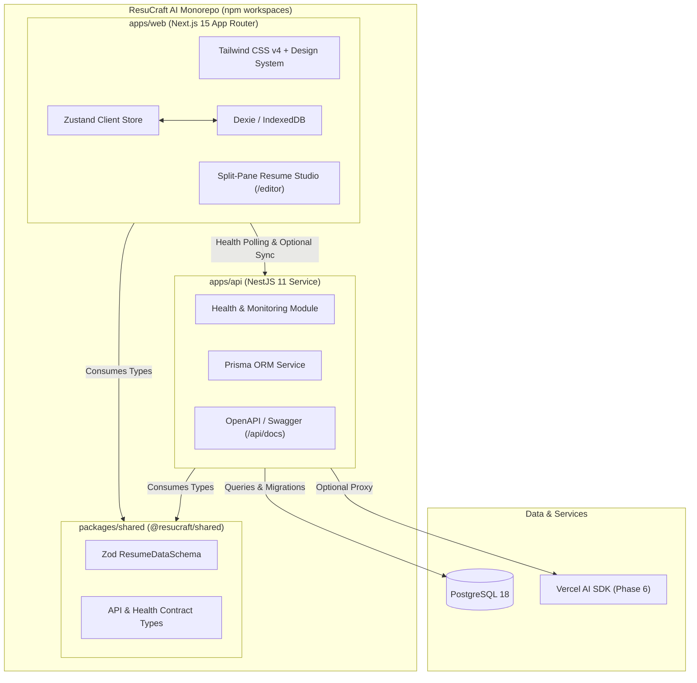

# ResuCraft AI — Architecture Specification

---

## 1. System Topology & Monorepo Boundaries

---

## 2. Application Boundaries & Responsibilities

1. **`apps/web` (Next.js 15 / React 19):**
   - Autonomous, local-first client application.
   - Operates completely offline without requiring API connectivity.
   - Enforces responsive, accessible UI using the pgAdmin-inspired color design system.
2. **`apps/api` (NestJS 11):**
   - Enterprise backend microservice on port 4000.
   - Provides `/api/health` system telemetry, database health checks, and Swagger documentation.
   - Prepared for Phase 6 AI gateway rate-limiting and Phase 7 optional Better Auth cloud synchronization.
3. **`packages/shared` (`@resucraft/shared`):**
   - Shared domain models, Zod validation schemas, and TypeScript interfaces.
   - Guaranteed single source of truth for JSON Resume v1.0.0 compliance.

---

## 3. Security Architecture (OWASP Top 10)
- **Helmet Headers:** Integrated on NestJS backend (`X-Content-Type-Options: nosniff`, `X-Frame-Options: DENY`).
- **CORS Allowlist:** Strictly locked to `http://localhost:3000`.
- **Global Pipes:** NestJS `ValidationPipe` with `whitelist: true` and `forbidNonWhitelisted: true`.
- **Database Safety:** Zero raw unescaped SQL; parameterized queries via Prisma ORM.
